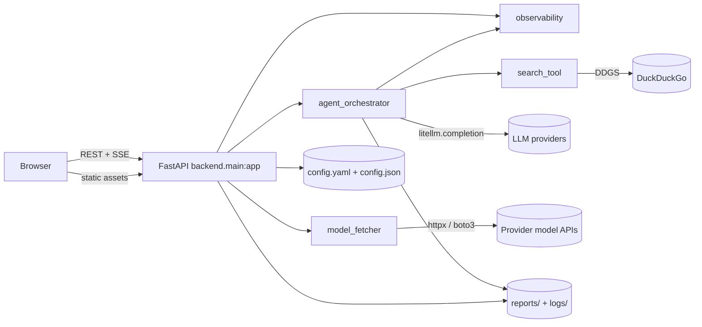
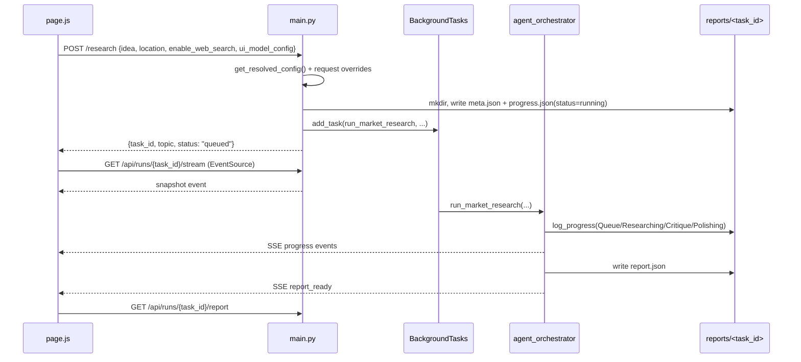
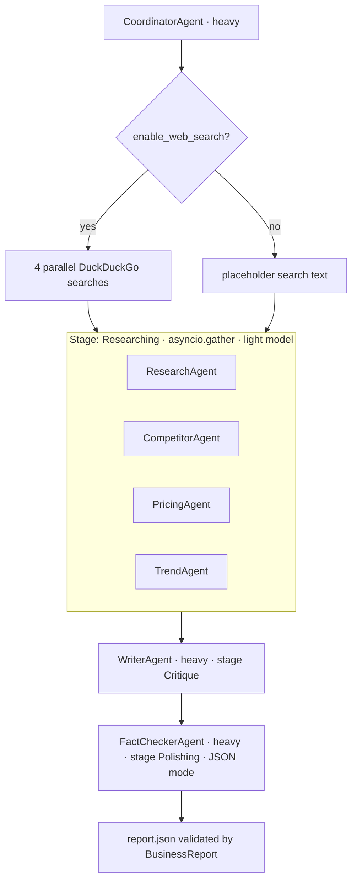
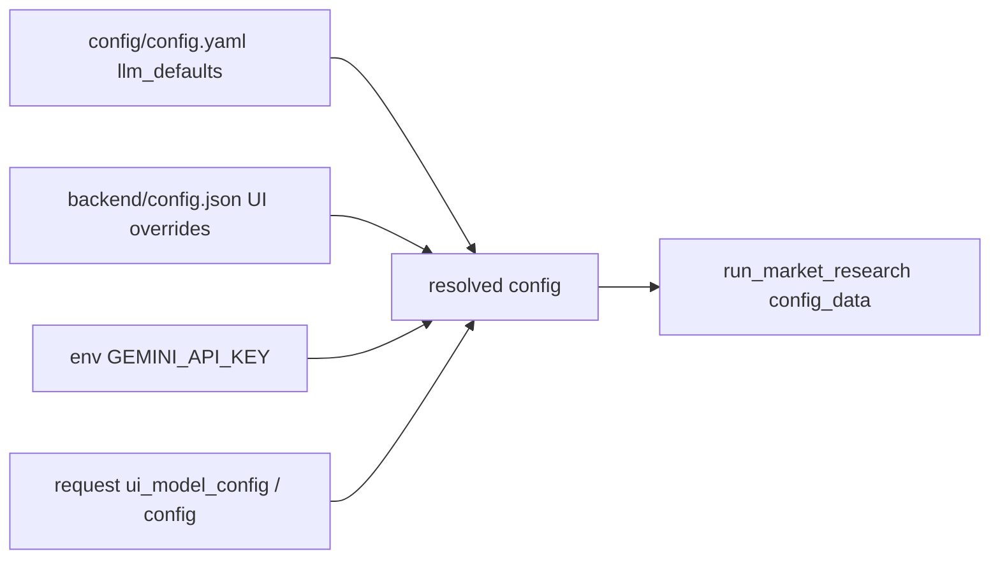
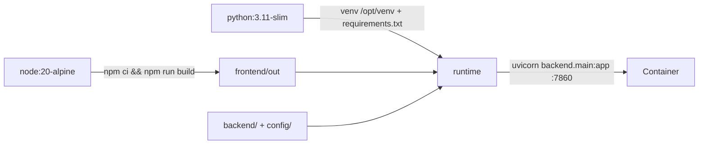

# ARCHITECTURE.md

How the system is put together. Source-verified against commit `f23c06e` on 2026-08-01.

---

## 1. System shape

Two deployables that ship as one container:

- **Backend** — FastAPI monolith (`backend/`), ASGI app `backend.main:app`.
- **Frontend** — Next.js App Router, statically exported to `frontend/out` and served by the same FastAPI process at `/`.

No database, no message broker, no external cache. Durable state is JSON files under `reports/<task_id>/`; audit trail is text under `logs/<YYYY-MM-DD>/`.

## 2. Layers and responsibilities

| Layer | Module | Responsibility | Must not |
| --- | --- | --- | --- |
| Transport | `backend/main.py` | Route definitions, Pydantic request models, config resolution, task directory bootstrap, SSE endpoint, static mount | Contain LLM or prompt logic |
| Orchestration | `backend/agent_orchestrator.py` | Pipeline sequencing, LiteLLM invocation, progress + SSE emission, cancellation, report schema coercion, mock mode | Import FastAPI |
| Provider metadata | `backend/model_fetcher.py` | List models per provider, TTL cache, pooled `httpx` client, boto3 Bedrock listing | Perform completions |
| Observability | `backend/observability.py` | IST timestamps, secret scrubbing, thread-offloaded session log writes | Hold business logic |
| Tooling | `backend/search_tool.py` | DuckDuckGo text search → formatted string; swallows its own errors | Raise to callers |
| Presentation | `frontend/app/page.js` | All UI state, API calls, SSE/polling, 5 tabs | Assume a Node server at runtime (static export) |
| Presentation (dumb) | `frontend/app/components/*` | Props-only rendering | Fetch or own state |
| Configuration | `config/config.yaml` | Environment, feature flags, model defaults, provider base URLs, **all prompts** | Contain secrets |

Dependency direction is one-way: `main → orchestrator → {observability, search_tool}`, `main → model_fetcher`, `main → observability`. No back-edges exist; do not add any.

## 3. HTTP surface

| Method | Path(s) | Handler | Notes |
| --- | --- | --- | --- |
| GET | `/api/health` | `health_check` | Adds `mock_llm` so a client can detect fixture mode |
| GET | `/api/config`, `/settings`, `/api/settings` | `get_config` | Returns resolved config with masked keys |
| POST | `/api/config`, `/settings`, `/api/settings` | `save_config` | Merges into `backend/config.json`; logs as `API Layer` |
| GET | `/api/runs` | `list_runs` | Joins `meta.json` + `progress.json`; adds `duration_ms`, `tokens`, `cost_usd` |
| POST | `/research`, `/api/research` | `trigger_research` | Writes `meta.json` + seeded `progress.json` (stage table), schedules the background task |
| GET | `/api/runs/{id}/progress` | `get_progress` | `{status, stages[], totals, logs[]}`; backfills `stages` for legacy files |
| GET | `/api/runs/{id}/stream` | `stream_progress` | SSE: `snapshot` then `progress` (carrying `stages`+`totals`) / `report_ready`; keepalive every 30 s |
| GET | `/api/runs/{id}/report` | `get_report` | 404 unknown, 500 failed run, 202 still generating, 200 report |
| GET | `/api/runs/{id}/export` | `export_report` | `format=json\|markdown`; ASCII-slugged `Content-Disposition` |
| GET | `/api/runs/compare` | `compare_runs` | Query ids are traversal-validated before any filesystem access |
| POST | `/api/runs/{id}/cancel` | `cancel_run` | Sets `asyncio.Event`, writes a `cancelled` progress entry |
| POST | `/api/runs/{id}/retry` | `retry_run` | Relaunches the stored topic as a **new** task id |
| DELETE | `/api/runs/{id}` | `delete_run` | `shutil.rmtree` of the run directory |
| POST | `/api/models` | `fetch_models` | openai / anthropic / gemini / ollama / bedrock / deepseek / qwen |
| POST | `/api/providers/test` | `test_provider_connection` | Reuses model listing as a probe; returns reachability + latency, never the key |
| GET | `/*` | `StaticFiles(frontend/out, html=True)` | Mounted last, only if the directory exists |

Every route declares a Pydantic `response_model`. Task ids are validated against
`^[A-Za-z0-9_-]{1,64}$` and resolved inside `REPORTS_DIR` (env-overridable), so anything
escaping the directory returns 404.

## 4. Research request flow

## 5. Agent pipeline

Stage → status transitions written to `progress.json`:
`Queue: running → completed` · `Researching: running → completed` · `Critique: running → completed` · `Polishing: running → success` (or `failed` / `cancelled` at any point).

Model tiering: light = Research/Competitor/Pricing/Trend; heavy = Coordinator/Writer/FactChecker. Each tier has its own provider, model and API key, resolved independently.

## 6. Configuration resolution

Inside the orchestrator the effective key per tier is `light_api_key or api_key` (same for heavy), and the model id is `provider/model` — except Bedrock, which becomes `bedrock/{converse|invoke}/{region}/{model}`.

## 7. Concurrency and blocking model

| Concern | Mechanism | Location |
| --- | --- | --- |
| Pipeline execution | `BackgroundTasks` on the running event loop | `main.trigger_research` |
| LLM calls | `loop.run_in_executor(None, litellm.completion)` | `run_litellm_agent` |
| Web searches | 4 × `run_in_executor` inside `asyncio.gather` | `run_market_research` |
| Light agents | `asyncio.gather` of 4 coroutines | `run_market_research` |
| Session log writes | `asyncio.to_thread(write_session_log)` | `observability.log_session_async` |
| progress.json writes | `threading.Lock` `_progress_lock` (read-modify-write) | `agent_orchestrator.log_progress` |
| Log file appends | `threading.Lock` `_log_lock` | `observability._write_with_lock` |
| SSE registry | `threading.Lock` `_sse_lock`, bounded `asyncio.Queue(64)` | `agent_orchestrator` |
| Cancellation | `dict[task_id] → asyncio.Event`, polled between stages | `cancel_events` |

Consequences: state is **per-process**. Multiple uvicorn workers would break SSE fan-out and cancellation, because `_sse_subscribers` and `cancel_events` are module-level dicts. Run a single worker.

## 8. Observability

- Session log path: `<WORKSPACE_DIR>/logs/<YYYY-MM-DD IST>/localuser_<session_id>.log` in `dev`/`local`/`development` environments; `<osusername>_<session_id>.log` otherwise (`config.yaml: environment`).
- Record shape: header line (IST time, API, agent, session) → `INPUT DATA` (scrubbed JSON) → `SCENARIO` → `OUTPUT DATA` or `ERROR DATA` → separator.
- Scrubbing: dict keys containing `key`/`password`/`secret`/`token` are masked; free text matching `sk-[A-Za-z0-9]{20,}` is masked inline.
- `session_id` originates in the browser (`sessionStorage.mr_session_id`), travels as `X-Session-ID`, and falls back to `sess_<5 hex>` server-side.

## 9. Frontend architecture

- `frontend/app/page.js` is the workspace shell: view routing, run selection, commands and
  the wiring between panels. Feature panels under `app/components/` are presentational and
  receive everything through props.
- `app/lib/` holds the seams: `api.js` (the only place `fetch` is called, one `ApiError`
  contract with an `offline` flag), `hooks.js` (external stores for media queries, WebGL,
  localStorage and the URL hash), `theme.js` (theme application + `useSceneTokens`),
  `format.js`, and `useRunStream.js` (SSE with polling fallback and stall detection).
- **One `<Canvas>`** for the app, lazy-loaded and `aria-hidden`: `SceneCanvas` decides
  whether to render at all, `Observatory` owns the scene graph, `Effects` the post stack.
  Repeated meshes are instanced; geometries are disposed on unmount; nothing allocates in
  `useFrame`.
- **Token layer** in `globals.css` is the single source of colour, space, radius, motion,
  elevation and z-index. Themes re-map semantic tokens only. `--three-*` hex mirrors let
  `THREE.Color` read the same ramp.
- Browser state is read through `useSyncExternalStore`, never a mount effect (ADR-016), and
  loading states are derived by comparing the id a result belongs to against the id being
  requested. There are no lint suppressions.
- Persistence: `localStorage` (`mr_theme`, `mr_canvas`, `mr_quality`, `mr_settings`,
  `mr_tour_done`, `mr_last_run`), `sessionStorage` for the session id. A pre-paint script
  in `layout.js` applies the stored theme to avoid a flash of the wrong palette.
- Deep links use `#run=<id>&tab=<tab>`; `writeHash` keeps it in sync with what is on screen.
- Static export (`output: 'export'`) means no server components with runtime data, no route
  handlers, no image optimisation.

## 10. Build and deployment

Image details: `WORKSPACE_DIR=/app`, `PORT=7860` (declared; CMD hard-codes 7860), `logs/` and `reports/` pre-created with `chmod 777`, non-root user UID 1000 (Hugging Face Spaces convention). `boto3` is **not** installed in the image, so Bedrock model listing fails there.

## 11. Known architectural gaps

1. Single-process assumptions (SSE registry, cancel events, model cache) block horizontal scaling.
2. No auth on any endpoint; task ids are the only capability and they are unvalidated in filesystem paths.
3. No retry/backoff around provider calls apart from the single Bedrock converse↔invoke fallback.
4. `progress.json` is rewritten whole under a lock on every entry — O(n²) writes for long runs.
5. UI stepper includes a `Refining` stage the backend never emits.

   *Resolved 2026-08-15* — the stage table is now driven by `PIPELINE_STAGES`
   (`Queue`, `Researching`, `Critique`, `Polishing`), shared by the orchestrator, the
   progress endpoint's legacy backfill and the UI's `STAGE_ORDER`.
