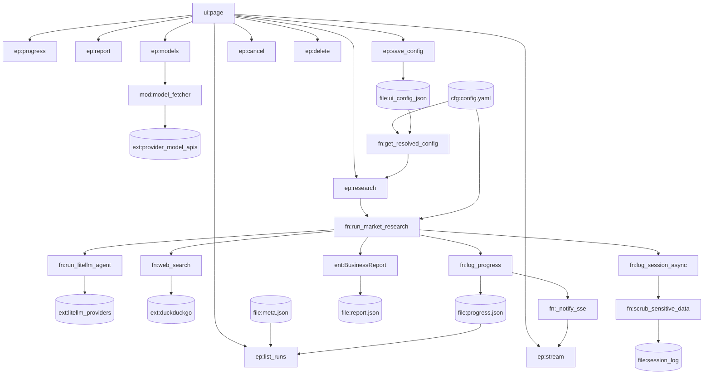

# KNOWLEDGE_GRAPH.md — Nodes, edges, impact analysis

Machine-friendly relationship map. Use it before editing to compute blast radius; update it whenever a dependency, endpoint or entity relationship changes.
Verified against commit `f23c06e` on 2026-08-01.

Node id convention: `mod:` module · `ep:` endpoint · `fn:` function · `ent:` entity/data structure · `file:` on-disk artefact · `ext:` external service · `cfg:` configuration · `ui:` frontend unit.

---

## 1. Nodes

### Modules
| Id | Path |
| --- | --- |
| `mod:main` | `backend/main.py` |
| `mod:orchestrator` | `backend/agent_orchestrator.py` |
| `mod:model_fetcher` | `backend/model_fetcher.py` |
| `mod:observability` | `backend/observability.py` |
| `mod:search_tool` | `backend/search_tool.py` |
| `mod:test_orchestrator` | `backend/test_orchestrator.py` |
| `ui:page` | `frontend/app/page.js` (workspace shell) |
| `ui:layout` | `frontend/app/layout.js` |
| `ui:scene` | `frontend/app/components/canvas/SceneCanvas.js` · `Observatory.js` · `Effects.js` |
| `ui:panels` | `frontend/app/components/*.js` (palette, drawer, timeline, log terminal, report, compare, history, toasts, tour, HUD) |
| `ui:lib` | `frontend/app/lib/` (`api.js`, `hooks.js`, `theme.js`, `format.js`, `useRunStream.js`) |
| `ui:styles` | `frontend/app/globals.css` (token layer) |
| `test:backend` | `backend/tests/` |
| `test:e2e` | `frontend/e2e/` + `frontend/playwright.config.mjs` |

### Endpoints
`ep:health` · `ep:get_config` · `ep:save_config` · `ep:list_runs` · `ep:research` · `ep:progress` · `ep:stream` · `ep:report` · `ep:export` · `ep:compare` · `ep:cancel` · `ep:retry` · `ep:delete` · `ep:models` · `ep:provider_test` · `ep:static`

### Key functions
`fn:get_resolved_config` · `fn:run_market_research` · `fn:run_litellm_agent` · `fn:log_progress` · `fn:_apply_stage_update` · `fn:_usage_of` · `fn:_notify_sse` · `fn:subscribe_sse` · `fn:log_session_async` · `fn:scrub_sensitive_data` · `fn:web_search` · `fn:mock_llm_enabled` · `fn:mock_report_fixture` · `fn:setup_litellm_mock_local` · `fn:_bedrock_model_id` · `fn:ProviderModelFetcher.*`

### Entities / artefacts / config / external
`ent:BusinessReport` · `ent:ResearchRequest` · `ent:UIModelConfig` · `ent:TaskModelConfig` · `ent:SettingsSaveRequest` · `ent:ModelFetchRequest`
`file:meta.json` · `file:progress.json` · `file:report.json` · `file:session_log` · `file:ui_config_json` · `file:frontend_out`
`cfg:config.yaml` (`cfg:prompts`, `cfg:llm_defaults`, `cfg:providers`, `cfg:features`, `cfg:environment`)
`ext:litellm_providers` · `ext:duckduckgo` · `ext:provider_model_apis` · `ext:bedrock`

---

## 2. Edges (typed)

### imports
- `mod:main` → `mod:orchestrator` (`run_market_research`, `cancel_events`, `subscribe_sse`, `unsubscribe_sse`)
- `mod:main` → `mod:observability` (`log_session_async`)
- `mod:main` → `mod:model_fetcher` (`ProviderModelFetcher`, `_get_client`)
- `mod:orchestrator` → `mod:observability`, `mod:search_tool`, `ext:litellm_providers`
- `mod:test_orchestrator` → `mod:orchestrator`, `mod:search_tool`
- `ui:page` → `ui:panels`, `ui:lib`, `ui:scene` (lazy); `ui:scene` → `ui:lib` (`theme`, `hooks`); `ui:layout` → `ui:styles`
- Only `ui:lib/api.js` calls `fetch`. Panels receive data through props and never fetch.
- **No back-edges.** `mod:orchestrator` must never import `mod:main`.

### defines
- `mod:main` defines all `ep:*` and `ent:ResearchRequest|UIModelConfig|TaskModelConfig|SettingsSaveRequest|ModelFetchRequest`
- `mod:orchestrator` defines `ent:BusinessReport`, `fn:run_market_research`, `fn:run_litellm_agent`, `fn:log_progress`, SSE registry functions

### reads / writes
- `fn:get_resolved_config` reads `cfg:llm_defaults`, `file:ui_config_json`, env `GEMINI_API_KEY`
- `ep:save_config` writes `file:ui_config_json`
- `ep:research` writes `file:meta.json`, `file:progress.json`
- `fn:run_market_research` reads `cfg:prompts`, `cfg:providers`, `cfg:features`; writes `file:meta.json` (model ids), `file:progress.json`, `file:report.json`
- `fn:log_progress` writes `file:progress.json` and calls `fn:_notify_sse`
- `fn:log_session_async` → `fn:scrub_sensitive_data` → writes `file:session_log`
- `ep:list_runs` reads `file:meta.json` + `file:progress.json`
- `ep:progress` reads `file:progress.json`; `ep:report` reads `file:report.json` + `file:progress.json`
- `ep:delete` removes the whole `reports/<task_id>` directory
- `ep:static` serves `file:frontend_out`

### calls
- `ep:research` → `fn:run_market_research` (via `BackgroundTasks`)
- `fn:run_market_research` → `fn:run_litellm_agent` ×7, `fn:web_search` ×4, `fn:log_progress`, `fn:log_session_async`
- `fn:run_litellm_agent` → `ext:litellm_providers` (`litellm.completion` in an executor), `fn:_bedrock_model_id` for `ext:bedrock`
- `fn:web_search` → `ext:duckduckgo`
- `ep:models` → `fn:ProviderModelFetcher.*` → `ext:provider_model_apis` / `ext:bedrock`
- `fn:setup_litellm_mock_local` monkey-patches `litellm.completion` process-wide

### validates / produces
- `ent:BusinessReport` validates the FactChecker output → produces `file:report.json`
- `ent:ResearchRequest` validates `ep:research` input
- `ent:ModelFetchRequest` validates `ep:models` input

### frontend → backend
- `ui:page` → `ep:save_config`, `ep:list_runs`, `ep:research`, `ep:stream`, `ep:progress`, `ep:report`, `ep:cancel`, `ep:delete`, `ep:models`
- `ui:page` renders fields of `ent:BusinessReport`, stage/status enums of `file:progress.json`, and run fields of `file:meta.json`

---

## 3. Graph

---

## 4. Impact analysis — "if I change X, I must also touch Y"

| Change | Also touch | Validate with |
| --- | --- | --- |
| `ent:BusinessReport` field | `schema_info` block + coercion list in `fn:run_market_research`; report tabs + Markdown export in `ui:page`; `ENTITIES.md` | Mock pipeline run + UI report tab |
| New/renamed pipeline stage | `fn:log_progress` call sites; stepper array and `getActiveStageIndex()` in `ui:page`; `orbToStage` map in `ui:agent_orb`; `.log-stage.*` styles in `ui:styles`; `ENTITIES.md` enums | Mock pipeline run + Tracker tab |
| New status value | `ep:list_runs`, `ep:report` branching; SSE close condition in `ep:stream` and `connectSSE`; badge styles | Mock pipeline run |
| New prompt/agent | `cfg:prompts`, `fn:run_market_research` sequence, `ENTITIES.md` agents table, `ARCHITECTURE.md` pipeline diagram | Mock pipeline run |
| New prompt placeholder | The matching `.format(...)` kwargs — otherwise `KeyError` | Mock pipeline run |
| New provider | `cfg:providers.base_url`, `ep:models` branch, `FALLBACK_MODELS` + provider `<select>` in `ui:page`, model-id construction in `fn:run_market_research` | `POST /api/models` + live run |
| New/changed endpoint | `ui:page` call site, `CLAUDE.md` §3 route table, `ARCHITECTURE.md` §3, this file | `curl` + UI smoke |
| Config key added | `fn:get_resolved_config` or `fn:load_yaml_config` consumer, `ENTITIES.md` §4 | Backend start + `GET /settings` |
| Logging/masking change | `fn:scrub_sensitive_data`, `fn:write_session_log`; verify no plaintext key lands in `logs/` | Run pipeline, grep the log file |
| Python dependency | `backend/requirements.txt` (and the Docker build) | Fresh venv install + `docker build` |
| Frontend dependency | `frontend/package.json` + lockfile | `npm --prefix frontend install && run build` |
| Static export behaviour | `frontend/next.config.mjs`, static mount in `mod:main` | `npm run build` then container run |
