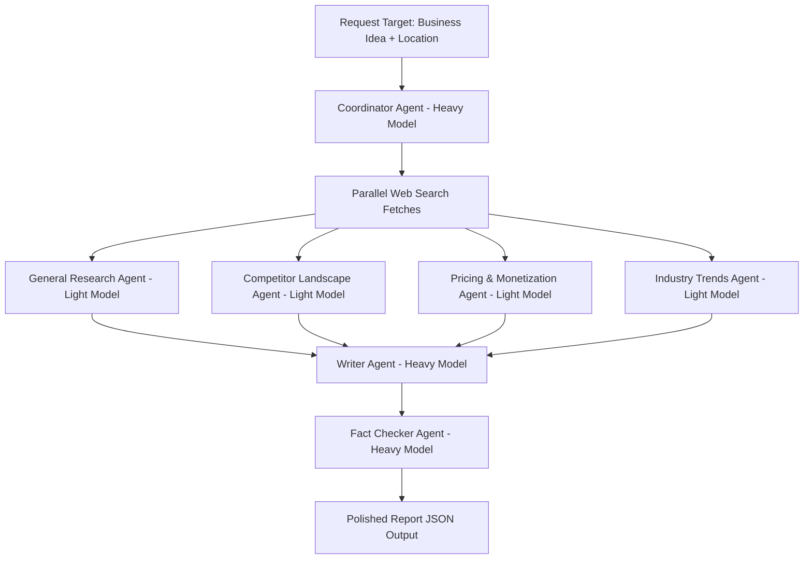

# AI Market Research Assistant (Config-Driven Multi-Agent System)

A full-stack, config-driven AI agent pipeline that gathers market details dynamically, evaluates drafts using a multi-agent critique layout, and compiles structured C-suite intelligence reports.

---

## 📖 Project Overview
The **AI Market Research Assistant** is designed to generate premium, comprehensive C-suite business reports from a single business idea and target location. It achieves this by coordinating specialized agents in a cost-optimized, sequential pipeline. By using **Light models** (fast, low-cost) for initial research phases and **Heavy models** (high-reasoning) for synthesis and auditing, the system optimizes token consumption while preserving analytical quality.

---

## ⚡ Key Features
* **Multi-Provider LLM Router**: Powered by `litellm` to support Ollama, OpenAI, Anthropic, DeepSeek, Gemini, Qwen, Bedrock and OpenAI-compatible endpoints natively.
* **Cost-Optimized Task Routing**: routes Research, Competitor, Pricing, and Trend tasks to a "Light Model" and routes Coordinator, Writer, and Fact Checker tasks to a "Heavy Model".
* **Live 3D Observatory**: a single WebGL canvas renders the pipeline as a constellation — each agent is an instanced luminous body whose colour, pulse and orbit follow real run state.
* **Pipeline Timeline & Scrubber**: per-stage duration, token count and cost, plus a scrubber that replays the run to any point.
* **Command Palette (`Ctrl`/`Cmd`+`K`)**: run research, jump to a past run, switch theme or model, open any report tab — the entire product is keyboard-reachable.
* **Run Comparison**: diff two completed runs section by section (SWOT, pricing, competitors and the rest).
* **Reading Mode & Export**: a distraction-free, print/PDF-friendly overlay, plus JSON/Markdown download, section copy and shareable deep links.
* **Session Resilience**: in-flight runs are restored after a reload, navigation away mid-run is guarded, and a stalled stream raises a reconnect banner.
* **Dynamic UI Model Switching**: providers and models per tier with search, masked key entry and a "test connection" probe that reports latency and reachability.
* **Premium Multi-Theme Support**: three themes — Dark, Light and Solarized — driven by one token layer that the DOM *and* the 3D materials both read.
* **Progressive Enhancement**: no WebGL, a small/low-power device, `prefers-reduced-motion`, or the canvas-off preference all fall back to a static token gradient with no animation loop.
* **Non-Blocking Observability System**: date-segregated session logs in Indian Standard Time (IST) written from background threadpools.
* **Zero-Leakage Key Masking**: recursively scrubs credentials, API keys and passwords from everything written to disk.
* **Offline Fixture Mode (`MOCK_LLM=1`)**: the entire pipeline runs deterministically with no provider credentials, no Ollama and no network.

---

## 📂 File Layout Structure

```
Multi-Agent Research System/
├── project_documentation.md      # This document
├── pytest.ini                    # Backend test configuration
├── config/
│   └── config.yaml               # Base truth configuration + all prompts
├── backend/
│   ├── config.json               # Runtime UI configuration overrides
│   ├── main.py                   # FastAPI monolith: routes, Pydantic models, SSE, static mount
│   ├── agent_orchestrator.py     # Pipeline, LiteLLM invocation, stage timing/cost, MOCK_LLM fixtures
│   ├── demo_seed.py              # LinkedIn Compare fixtures + launch topic
│   ├── linkedin_demo.py          # One-command presenter: MOCK_LLM + seed + ?demo=1
│   ├── search_tool.py            # DuckDuckGo wrapper (fixture results under MOCK_LLM)
│   ├── observability.py          # Non-blocking thread log engine (IST + masking)
│   └── tests/                    # pytest suite (unit + API contract)
├── start-linkedin-demo.sh        # Windows/macOS launcher for the speaking script
├── start-linkedin-demo.cmd
├── docs/LINKEDIN_DEMO.md         # End-to-end LinkedIn speaking script
├── frontend/                     # Next.js App Router, statically exported to frontend/out
│   ├── playwright.config.mjs     # E2E harness: real browser vs. real server, MOCK_LLM=1
│   ├── e2e/                      # journey · resilience · a11y · performance · responsive
│   └── app/
│       ├── layout.js             # Metadata, viewport, pre-paint theme bootstrap
│       ├── page.js               # Workspace shell: state, views, commands
│       ├── globals.css           # THE token layer + theme remaps + component styles
│       ├── lib/
│       │   ├── api.js            # Every network call, one error contract
│       │   ├── hooks.js          # External stores: media, WebGL, localStorage, URL hash
│       │   ├── theme.js          # Theme application + the 3D token bridge
│       │   ├── format.js         # Duration/cost/token/prose formatting
│       │   └── useRunStream.js   # SSE with polling fallback and stall detection
│       └── components/
│           ├── canvas/           # SceneCanvas · Observatory · Effects
│           └── *.js              # Palette, drawer, timeline, log terminal, report, compare…
├── logs/                         # Session logs, date-segregated
└── reports/                      # Generated task reports
    └── [task_id]/
        ├── meta.json             # Task metadata & models utilized
        ├── progress.json         # Status, stage table, totals, log entries
        └── report.json           # C-suite structured report data
```

---

## 🏗️ Architecture & Sequential Routing

The system runs as a FastAPI monolith backend coupled with a Next.js App Router frontend:



1. **Coordinator Agent (Heavy model)**: Receives inputs, plans the workflow steps, and initiates the research threads.
2. **Specialized Light Agents (Light model)**: Conduct fast parallel research for General Market Overview, Competitor Analysis, Pricing, and Trends. Default local model is `ollama/llama3.1:8b`.
3. **Writer Agent (Heavy model)**: Synthesizes individual drafts into an integrated business intelligence draft.
4. **Fact Checker Agent (Heavy model)**: Auditor that refines the text, critiques SWOT gaps, and formats JSON outputs to align with the database validation schema.

---

## 🛠️ REST API Contract

Served on port `8000` in development; in a container the same process also serves the
static UI at `/`. Every row below is covered by a test in `backend/tests/`.

| Method | Path | Request | Success | Errors |
| --- | --- | --- | --- | --- |
| GET | `/api/health` | — | `{status, reports_dir_writable, config_yaml_present, mock_llm}` | — |
| GET | `/api/demo` | — | `{status, seeded, runs[], launch}` — inspect only, no writes | — |
| POST | `/api/demo/seed` | `{}` | Writes the two LinkedIn Compare fixtures; idempotent | — |
| GET | `/api/config` · `/settings` · `/api/settings` | — | Resolved config with **masked** keys | — |
| POST | `/api/config` · `/settings` · `/api/settings` | `SettingsSaveRequest` | `{status, message}` | 500 write failure |
| GET | `/api/runs` | — | `RunSummary[]` incl. `status`, `duration_ms`, `tokens`, `cost_usd` | — |
| POST | `/research` · `/api/research` | `ResearchRequest` | `{task_id, topic, status:"queued"}` | 400 no topic · 422 oversized · 500 launch failure |
| GET | `/api/runs/{id}/progress` | — | `{status, stages[], totals, logs[]}` | 404 unknown/invalid id · 500 unreadable |
| GET | `/api/runs/{id}/stream` | — | SSE: `snapshot` → `progress`* → `report_ready` | 404 unknown id |
| GET | `/api/runs/{id}/report` | — | `ReportResponse` | 202 still generating · 404 unknown · 500 failed run |
| GET | `/api/runs/{id}/export?format=json\|markdown` | — | File download | 202/404/500 as above · 422 bad format |
| GET | `/api/runs/compare?a=&b=` | — | `{a, b, sections[]}` per-section diff | 400 same id · 404 unknown id |
| POST | `/api/runs/{id}/cancel` | — | `{status:"success"\|"ignored", message}` | 404 unknown id |
| POST | `/api/runs/{id}/retry` | — | `{task_id, topic, status:"queued"}` (new id) | 404 unknown · 422 no topic |
| DELETE | `/api/runs/{id}` | — | `{status, message}` | 404 unknown · 500 delete failure |
| POST | `/api/models` | `ModelFetchRequest` | `{provider, models[]}` | 400 bad provider/key/base_url · 502 provider failure |
| POST | `/api/providers/test` | `{provider, api_key?, base_url?}` | `{reachable, latency_ms, model_count, detail}` | 422 no provider |
| GET | `/*` | — | Static export from `frontend/out` (mounted last) | — |

Task ids are validated against `^[A-Za-z0-9_-]{1,64}$` and resolved inside `REPORTS_DIR`;
anything that escapes returns **404**, so probing cannot distinguish invalid from missing.
API keys are never echoed back by any endpoint.

---

## 🎨 Design System

Aesthetic anchor: **"observatory"** — a dark control room where each agent is a luminous
body and the report is the constellation they resolve into.

Every colour, space, radius, duration and z-index lives in one token layer at the top of
[frontend/app/globals.css](frontend/app/globals.css). Themes re-map semantic tokens **only**;
no component hard-codes a value.

| Group | Tokens | Notes |
| --- | --- | --- |
| Type | `--font-sans` `--font-display` `--font-mono`, `--t-2xs` … `--t-3xl` | One display face (Outfit) for headings, Inter for data, JetBrains Mono for logs. Body line-height 1.6, prose capped at `--measure` (72ch). |
| Space | `--sp-1` … `--sp-16` | 4px base scale. |
| Radius | `--r-sm` `--r-md` `--r-lg` `--r-xl` `--r-full` | |
| Motion | `--ease`, `--dur-1` (100ms) `--dur-2` (200ms) `--dur-3` (400ms) | One easing family, three durations. Motion signals causality; it never decorates. |
| Elevation | `--e-1` … `--e-4` | A real shadow ramp, per theme. |
| z-index | `--z-canvas` `--z-content` `--z-sticky` `--z-drawer` `--z-overlay` `--z-toast` `--z-palette` | The full ladder; no ad-hoc values. |
| Surface | `--bg-base` `--surface` `--surface-solid` `--surface-2` `--border` `--scrim` `--input-bg` `--console-bg` | `--surface` is a blurred **and** opaque scrim, so HTML over the canvas always passes contrast. |
| Colour | `--primary` `--secondary` `--accent` `--success` `--danger` `--warning` `--info` `--text` `--text-muted` `--text-dim` `--focus-ring` | |
| 3D bridge | `--three-bg` `--three-primary` `--three-secondary` `--three-accent` `--three-danger` `--three-dim` `--three-star` | Hex mirrors of the same ramp, in a form `THREE.Color` can parse. Read through `useSceneTokens()`, which watches `data-theme`, so the canvas re-themes with the DOM. |

**State completeness.** Every surface defines empty, loading (skeleton — never a spinner),
partial, error (with a recovery action) and success.

**Error contract.** Transient background events → toast. Field-level problems → inline
message tied to the input with `aria-describedby`. Unreachable backend → persistent banner
with retry. Nothing is swallowed.

---

## 🌌 The 3D Layer & Its Fallbacks

One `<Canvas>` for the whole app, mounted in [frontend/app/components/canvas/SceneCanvas.js](frontend/app/components/canvas/SceneCanvas.js).

* **Scene graph** — an instanced starfield (`THREE.Points`, seeded so it is identical on
  every load), one `instancedMesh` for all seven agent bodies, one `lineSegments` for all
  nine links, an ambient + two-point lighting rig, and a camera rig that drifts gently and
  parks beside each agent during the onboarding tour.
* **Budget** — repeated geometry is instanced, nothing is allocated inside `useFrame`, and
  every geometry built with `new` is disposed in an effect cleanup. Post-processing is two
  effects (bloom + vignette), lazy-loaded and only at medium/high quality with motion on.
* **Quality** — Low/Medium/High change DPR, sphere segments, star count, antialiasing and
  whether post-processing mounts. Three consecutive seconds under 40fps step the level down
  automatically; it never steps back up on its own.

The canvas is **progressive enhancement**. It is replaced by a static token gradient when:

| Condition | Behaviour |
| --- | --- |
| No WebGL context | `data-scene="static"` gradient; no Three.js is even imported |
| Viewport ≤ 860px / touch device | Same static gradient — the GPU is never engaged on a low-power device |
| `prefers-reduced-motion: reduce` | Canvas still renders, but `frameloop="demand"` **stops the loop entirely**; CSS animations are disabled too |
| "3D canvas" preference off | Static gradient, persisted in LocalStorage across sessions |
| Scene chunk still loading | `<Suspense>` fallback renders the gradient |

Accessibility: the canvas is `aria-hidden` throughout — it is decoration over a complete
DOM UI. Landmarks, a skip link, focus traps in overlays, `aria-live` pipeline status and a
fully keyboard-navigable journey are all part of the DOM layer, not the canvas.

---

## 🧪 Offline Fixture Mode (`MOCK_LLM=1`)

Set `MOCK_LLM=1` and the whole pipeline runs deterministically with **no provider
credentials, no Ollama and no network**:

* `litellm.completion` is replaced by a fixture responder that returns stage-appropriate
  text and a report derived from the topic — two runs of the same topic produce identical
  reports.
* `web_search()` returns fixture results instead of calling DuckDuckGo.
* Token counts are fixed, so per-stage token/cost readouts are stable.
* `GET /api/health` reports `mock_llm: true` so a client can tell.

| Variable | Default | Purpose |
| --- | --- | --- |
| `MOCK_LLM` | unset | `1`/`true`/`yes`/`on` enables the fixture pipeline |
| `MOCK_LLM_DELAY_MS` | `0` | Artificial per-call latency. The E2E harness sets `600` so mid-run states (cancel, live progress) are reachable |
| `REPORTS_DIR` | `<workspace>/reports` | Redirect run storage — used by E2E so tests never touch your runs |
| `ALLOWED_ORIGINS` | localhost:3000/3001 | Comma-separated CORS allow-list |

A per-request alternative also still works: any API key beginning with `MOCK` activates the
same fixture path for that run only.

```bash
# One-off offline run
MOCK_LLM=1 py -m uvicorn backend.main:app --port 8000
```

---

## 🚀 Setup & Installation

### Prerequisites
* **Python 3.10+** (tested on 3.11). On Windows the `py` launcher is used below; on
  macOS/Linux substitute `python3`.
* **Node.js 18+** with `npm`.

### 1. Backend
```bash
# From the repository root
py -m venv .venv
.venv/Scripts/python -m pip install -r backend/requirements-dev.txt   # runtime + pytest
# macOS/Linux: python3 -m venv .venv && .venv/bin/pip install -r backend/requirements-dev.txt
```

> `fastapi>=0.115` is a hard floor: earlier Starlette releases ship a `TestClient` that
> cannot construct an `httpx>=0.28` client, and the whole test suite errors out.

### 2. Frontend
```bash
cd frontend
npm install
npx playwright install chromium   # only needed to run the E2E gauntlet
```

---

## ⚙️ Running Locally

### Two-server development (hot reload)
```bash
# Terminal A — API on :8000
py -m uvicorn backend.main:app --host 0.0.0.0 --port 8000 --reload

# Terminal B — UI on :3000 (talks to :8000 automatically)
npm --prefix frontend run dev
```
* API: `http://localhost:8000` · Swagger: `http://localhost:8000/docs`
* UI: `http://localhost:3000`

### Single-origin (production shape)
```bash
npm --prefix frontend run build          # static export → frontend/out
py -m uvicorn backend.main:app --port 8000
```
FastAPI serves the export at `/` with every `/api` route taking precedence, which is exactly
how the container runs.

### Offline demo, no credentials
```bash
npm --prefix frontend run build
MOCK_LLM=1 MOCK_LLM_DELAY_MS=600 py -m uvicorn backend.main:app --port 8000
```

### LinkedIn presenter (scripted walkthrough)
```bash
./start-linkedin-demo.sh
# Windows: start-linkedin-demo.cmd
# or: py -m backend.linkedin_demo
```
Opens `http://localhost:8000/?demo=1` with the tour skipped, the coffee / Bengaluru launch fields filled, two Compare runs seeded, and on-screen speaking cues from [docs/LINKEDIN_DEMO.md](docs/LINKEDIN_DEMO.md).

---

## 💡 Usage & User Journey

### 1. Dashboard
The command center tracks total orchestrations, completed reports, cumulative tokens and
spend, and lists every past run with its duration, cost and model tiers. A first-visit
camera tour names each agent in the constellation and is remembered in LocalStorage.

### 2. Settings drawer
Open **Settings** (or `Ctrl`/`Cmd`+`K` → "Open settings") to configure both tiers:
- **Ollama**: pick `llama3.1:8b`; no API key required.
- **Cloud providers**: pick OpenAI, Anthropic, Gemini, DeepSeek, Qwen or Bedrock and paste
  your key. Keys live in **this browser's LocalStorage** and are only ever sent as request
  payload; the UI shows them masked.
- **Test connection** reports reachability, latency and how many models the provider offers.
- **Offline**: run the server with `MOCK_LLM=1`, or type a key starting with `MOCK`.

### 3. Launching research
**New research** → business idea (required) and target location (optional). Submitting is
optimistic: the form collapses into the live telemetry view the instant the task is queued —
there is never a blocking spinner.

### 4. Tracking the pipeline
Telemetry shows the four backend stages (Coordinate → Research → Synthesise → Audit) with
per-stage duration, token count and cost, a scrubber that replays the run to any point, and
a streaming log terminal with severity filtering, search, copy and a "jump to latest" pill.
The constellation behind it lights up in step. Cancel is available while the run is live;
closing the tab mid-run raises a confirmation, and reopening restores the run.

### 5. Reading the report
Five tabs — Executive Summary, Market & Competitors, SWOT Analysis, Critique &
Refinements, Raw JSON — plus reading mode (distraction-free, print/PDF friendly), section
copy, JSON/Markdown export and a shareable deep link (`#run=<id>&tab=<tab>`).

### 6. Comparing runs
**Compare** diffs two completed runs section by section, marking each as identical or
changed alongside their duration, token and cost figures.

---

## 📝 Observability & Logging System
The system records enqueued request flows inside date-segregated files:
`logs/YYYY-MM-DD/localuser_<session_id>.log`
* **IST Timestamping**: Timestamps are locked to Indian Standard Time (UTC+5:30) for unified traceability.
* **Zero-Leakage Key Masking**: Credentials, API tokens, and passwords inside the payload inputs are automatically scrubbed and replaced with masked parameters (e.g., `sk-123...4567` or `MOCK_K...IGHT`).
* **Non-blocking Threads**: File writes are executed asynchronously using python thread pools (`asyncio.to_thread`) to prevent blocking FastAPI request handlers.

---

## 🧪 Test Gauntlet

| Layer | Command | What it proves |
| --- | --- | --- |
| Static | `npm --prefix frontend run lint` | ESLint + React Compiler rules clean |
| Static | `npm --prefix frontend run build` | Static export compiles and prerenders |
| Unit + contract | `py -m pytest backend/tests -q` | Every API contract row, path-traversal guards, CORS, secret masking, stage accounting, the `MOCK_LLM` pipeline |
| E2E | `npm --prefix frontend run test:e2e` | Real Chromium against the real FastAPI server with `MOCK_LLM=1` |

The Playwright harness boots `uvicorn` itself (`playwright.config.mjs`), points
`REPORTS_DIR` at `./.e2e-reports` so your own runs are untouched, and covers five layers:

* `e2e/journey.spec.js` — submit, watch progress, stage timings, every report tab, theme
  switching, command palette, export, comparison, deep-link reload.
* `e2e/resilience.spec.js` — backend down, 500s, malformed JSON, empty report, rapid double
  submit, cancel mid-run, back/forward, optimistic-delete rollback.
* `e2e/a11y.spec.js` — axe (zero critical/serious) in all three themes on dashboard and
  report, skip link, keyboard-only journey, `aria-live`, focus trapping, reduced motion,
  canvas-off persistence.
* `e2e/performance.spec.js` — draw-call budget, manual quality degrade, heap growth across
  repeated view churn, context release when the canvas is switched off.
* `e2e/responsive.spec.js` — 360px, tablet and desktop layouts with no horizontal overflow.

Add `?perf=1` to any URL to show the otherwise dev-only renderer HUD (fps, draw calls,
triangles, geometries, heap) with its manual quality switch.

---

## 🚢 Deployment Strategies

### A. Backend Monolith (FastAPI)
The backend can be containerized using a simple `Dockerfile` at the workspace root:
```dockerfile
FROM python:3.11-slim
WORKDIR /app
COPY ./backend /app/backend
COPY ./config /app/config
RUN pip install --no-cache-dir fastapi uvicorn litellm PyYAML duckduckgo-search pydantic python-dotenv
EXPOSE 8000
CMD ["uvicorn", "backend.main:app", "--host", "0.0.0.0", "--port", "8000"]
```
You can deploy this container directly to serverless container hosts like **Google Cloud Run**, **AWS Fargate**, or **Render**. Ensure you configure `environment: prod` in container environment variables to adapt server session log filenames to cloud users.

### B. Frontend Client (Next.js)
* **Vercel Deployment**: Connect the git repository directly to Vercel for zero-config Next.js deployments.
* **Static Export**: You can run `npm run build` with `output: 'export'` configured in `next.config.js` to compile the app into static HTML/CSS/JS assets, which can then be deployed to static CDNs (AWS S3, Firebase Hosting, GitHub Pages).

---

## 🛠️ Troubleshooting

### 1. Ollama Connection Refused
* **Issue**: Error log `Connection refused` when utilizing Ollama.
* **Solution**: Ensure the Ollama daemon is running locally (`ollama run llama3.1:8b` or verify `http://localhost:11434` in your web browser).

### 2. CORS Errors in Web Console
* **Issue**: Next.js (port 3000) fails to fetch configurations from FastAPI (port 8000).
* **Solution**: Ensure FastAPI CORSMiddleware has `allow_origins=["*"]` configured (which is active by default in [main.py](file:///Users/apple/Desktop/Multi-Agent%20Research%20System/backend/main.py)).

### 3. Log Directory Permissions
* **Issue**: `PermissionError` or missing log directories.
* **Solution**: The system creates a top-level `/logs` folder dynamically. Ensure the server execution user has write access to the workspace root directory.
